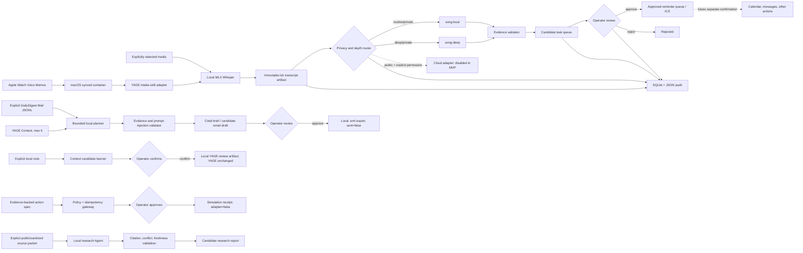

# Architecture

## Design principle

LocalOps separates capture, evidence, proposals, approval, reminders, and external execution. This follows YAGE's idea that small tools should compound through explicit interfaces while personal rules remain owned by the local operator.



## Trust boundaries

1. Audio and transcript are local evidence.
2. An LLM output is a proposal, even when confidence is high.
3. Every task needs a quote that can be found in the source text.
4. Approval changes task state; it does not authorize unrelated external actions.
5. Each eventual external executor must have its own narrow permission and success evidence.
6. Mail collection is owned by the existing read-only DailyDigest pipeline; LocalOps consumes only an explicitly selected normalized artifact.
7. The planner may select safe read-only tools, but sending email is absent from its tool catalog.
8. Raw model output can drift from the requested schema; deterministic normalization may accept known aliases only when citations still match exactly.
9. If one bounded retry still fails, policy code may select only explicitly requested safe tools and return only extractive evidence or a conservative candidate draft. This fallback cannot approve, send, or weaken citation checks.
10. Context learning is a proposal flow, not automatic memory mutation; only confirmed candidates can be exported, and export does not modify YAGE.
11. Action approval and action execution are separate capabilities. In the current release, execution is simulation-only and all adapters remain disabled.
12. Research accepts only an explicit public/sanitized source packet; URLs are provenance metadata, not permission to browse or retrieve.

## Bounded operations loop

The operations agent has a deliberately small action space: retrieve at most six YAGE items, ingest an explicitly named Mail JSONL, prepare a cited brief, prepare a candidate email, ask the operator, or stop. A run records its plan, tool results, evidence references, raw structured model result, normalization warnings, and external-action status. It has no recursive open-ended shell, browser, send, mailbox-mutation, or cloud tool.

Model-generated email text remains untrusted. If deterministic checks detect unsupported completion/commitment language, LocalOps replaces it with a conservative acknowledgement candidate and records the rewrite. Human approval remains mandatory.

## Evaluation boundary

The eval runner isolates each synthetic trial in a temporary state directory and grades both outcomes and trajectories: selected tools, candidate status, exact evidence quotes, required source references, trace completeness, absence of send events, and `external_actions: none`. Reports retain raw failure summaries, latency, and fallback warnings. These tests measure the governed system on selected synthetic cases; they do not establish real-data or production performance.

## Phase 2-4 state machines

```text
Context: explicit source -> candidate -> confirmed/rejected -> local export
Action:  explicit spec -> candidate -> approved/rejected -> simulated
Research: explicit public/sanitized packet -> validated candidate report
```

Each transition is stored in SQLite and audited. There is intentionally no transition from `simulated` to externally executed in this release.

## Why two local models

The 9B model is the daily worker. The 35B model is a scarce local reviewer because it can trigger substantial swap pressure on a 48GB Mac. The router therefore treats “deep” as an explicit mode and unloads the larger model after processing.

## Upstream boundary

`skills/intake-skill` is an MIT-licensed upstream project by the YAGE author/contributors. LocalOps does not alter its narrow Voice-Memos-only scope. The LocalOps contribution begins at orchestration: existing-ASR integration, model routing, evidence checks, task lifecycle, reminders, audit, and portfolio-safe synthetic testing.
